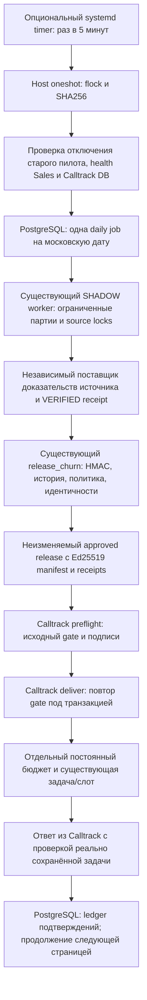

# Постоянная автоматизация «Риск ухода»: архитектура и разрешённое включение

**По умолчанию выключена. Этот документ не является разрешением на production-запуск.**
Изменения не устанавливались на VPS. Слияние PR само по себе не включает сценарий.
Не считать SQLite/mocked-тесты доказательством доставки в production-Calltrack.

## Что проверено, а что недоступно

Исходная Sales Journal: `a56c677e747a` (main после PR #168). Изучены
`app.analytics_worker`, `app.analytics_automation`, `services/analytics_signal_worker.py`,
`analytics_automation.py`, `churn_pilot.py`, `analytics_source.py`, `analytics_signal_store.py`,
`routers/analytics_delivery.py`, модели автоматизации, мониторинг и интерфейс сценария.

Calltrack изучен по GitHub checkout `cfbab96539bbcadcf1963991f77c10ccc78ce5a8`:
`api/analytics_integration.php`, `analytics_sync.php`, `analytics_verified_approval.php`,
`analytics_signed_evidence.php`, `analytics_verified_export.php`, `analytics_source_trust.php`,
`analytics_task_policy.php`, `analytics_budget_service.php`, `analytics_manager_pilot_budget.php`,
`manager_tasks_service.php`, тестовая SQLite-схема `tests/fixtures/analytics/database.php`.
Companion patch применяется к этому исходнику в отдельной локальной копии для тестов.
Совпадение остальных файлов с VPS не установлено.

Нет доступа к VPS, его MariaDB, ключам, приватной конфигурации, действующему pilot.py,
его unit-файлам, server-only Compose overrides, реальному update_sales.sh и расписаниям.
Ничего из перечисленного не считается проверенным или установленным.

Результаты сравнения двух известных manager_tasks_service.php находятся в
[аудите целостности](audits/churn-integrity-20261030.md). Изменение
`f04e422e…56bbc` → `8f6382d5…8f7d` разрешает редактировать выполненную задачу,
сохраняя DONE; не отменяет права, optimistic locking или запрет переоткрытия.
**Новый companion patch меняет и этот файл, и analytics_integration.php.** Поэтому
одного ранее подготовленного патча SHA для manager_tasks_service.php недостаточно.
Все новые исполняемые байты и зависимости требуют отдельного аудита/утверждения.
Автоматического обновления манифеста нет.

## Поток выполнения



Таймер не считает отчёт каждые пять минут. Он проверяет утверждённое время HH:MM
по Europe/Moscow, продолжает ограниченную порцию работы текущей daily job и обновляет
диагностику. После завершения job за эту дату новых расчётов не создаёт.
`Persistent=false`: нет автоматического запуска пропущенных исторических дней.
При восстановлении в тот же день job продолжается; вчерашние выпуски не отправляются.

Хост запускает фиксированные `docker exec … python -m app.churn_automation` и локальный
`php …/api/analytics_permanent_cli.php`. Новой публичной точки создания задач нет.
Bearer/mTLS существующего pull API не изменены; сам хост использует локальный PHP
процесс и существующую приватную конфигурацию Calltrack. Backend не получает Docker
socket, host root, upstream signing key или право выполнения команд через HTTP.

### Сохранённые правила

Алгоритм `aviator-churn-pilot/2` не меняется: риск только при превышении медианного
индивидуального цикла, без фиксированного приоритета 45 дней. Сохранены существующие
scope Авиаторов/Оптовик/Корпоративный, положительные дни, исключение возвратных
документов, scoring/confidence и проверка source revision. Расчёт по-прежнему SHADOW;
это не разрешение на задачи.

`release_churn()` по-прежнему требует независимый HMAC manifest, актуальный закрытый
день, неизменный источник, утверждённую native policy, уникальные VERIFIED привязки и
подтверждённого менеджера. Ни PRELIMINARY_MATCH, ни REVIEW не конвертируются автоматически.
Calltrack дополнительно проверяет **свои** Ed25519 source/identity envelopes, текущую
группу клиентов, binding revision, менеджера, approved generator/scope/confidence,
приоритет и срок из существующей утверждённой task policy.

Существующий Calltrack verifier ограничивает reviewed managers ID 3 и 6. Это
ограничение здесь не расширяется. Для других менеджеров требуется отдельный аудит
и согласованное изменение протокола, а не подстановка ID.

### Отдельная постоянная политика

`churn_schedule` в PostgreSQL: ревизия, approved/enabled, HH:MM, daily_limit 1–100,
cooldown_days 1–3650, версия алгоритма, точные approved revisions native producer и
Calltrack permanent policy. Значений лимита по умолчанию нет. Верхние границы —
технические предохранители, не рекомендуемые объёмы создания задач.

На Calltrack добавляются три небольшие InnoDB-таблицы:
`analytics_permanent_policy`, `analytics_permanent_reservations`,
`analytics_permanent_policy_events`. Seed выключен/не утверждён, лимит 0.
Draft снимает approval и выключает политику; approve увеличивает revision, но
оставляет enabled=false; enable — отдельное аудируемое действие.
Любое изменение времени, лимита, cooldown или связанной ревизии требует нового
утверждения. Увеличение лимита не выполняется автоматически.
Уже созданная daily job не перепривязывается к новой ревизии; если политику изменили
после её создания, новая утверждённая ревизия применяется к следующему дню.

Новый бюджет применяется только к явно маркированному permanent event, с точным
совпадением обеих утверждённых политик. Все криптографические gates остаются.
Обычные/пилотные события продолжают использовать старые lifetime/daily/manager caps.
Пилотные 10 задач, 5/день и 5 на первоначального менеджера **не обнуляются**,
не увеличиваются и не интерпретируются как бюджет постоянного режима.

Единая блокировка строки permanent policy сериализует проверку дневного лимита и
резервирование. Резерв, task, slot, inbox и processing event сохраняются в одной
существующей транзакции. Сбой откатывает резерв вместе с задачей. Закрытие/переназначение
задачи не возвращает дневной лимит. Дата резервирования — Europe/Moscow.

### Повторные задачи и доставка

Сохранены signal key, unique slot INACTIVITY, same-revision/content conflict, проверка
истории purchase anchor и reviewed peer IDs. Повтор неизменённого события возвращает
существующую задачу. Закрытая задача того же purchase anchor не переоткрывается.
Новая задача допустима лишь после **более поздней фактической покупки** и истечения
утверждённого cooldown с создания предыдущей автоматической задачи (включая peers).
Смена менеджера существующей задачи отправляется на REVIEW, не переназначает её.

Ledger `churn_receipts` хранит event ID/hash, decision, task ID, безопасные коды причин,
observed_at и подтверждённый признак создания задачи этим выпуском. Если ответ после
commit потерян, следующая попытка отправляет **тот же** event, не собирает его заново.
TASK_EXISTS с задачей, созданной именно этим выпуском, корректно учитывается после
потери первого ответа. Неизвестный исход не подменяется успехом/нулём.

Перед каждой страницей применяются **те же** проверки, что у approved HTTP feed:
политика/algorithm/source revision/import/срок manifest/закрытый день/VERIFIED guards.
Новая проверка permanent schedule защищает и host CLI, и существующий pull feed.
Disable останавливает следующую страницу; уже начатая атомарная транзакция Calltrack
может завершиться. Для немедленного operational stop отключить также receiver policy,
остановить timer и дождаться oneshot — по согласованной процедуре.

## Недоступный независимый поставщик доказательств — явная блокировка

В старом server-only pilot возможен соответствующий механизм, но его исходник
недоступен. Здесь **не выдуман** его API и не создан signer, который подтверждает
полноту на основании тех же непроверенных локальных продаж.

Host ожидает отдельно проверенный `/usr/local/libexec/sales-churn-evidence`.
stdin: `{"job_id":"…","run_id":"…"}`. stdout — один bounded JSON до 4 MiB:

```json
{
  "manifest": {"payload": {}, "signature": "HMAC SHA256 hex"},
  "receiver_evidence": {
    "upstream_manifest": {"algorithm":"Ed25519","key_id":"approved-key","payload_json":"canonical source payload","signature":"base64"},
    "binding_receipts": {
      "verified-client-id": {"algorithm":"Ed25519","key_id":"approved-bindings-key","payload_json":"canonical VERIFIED receipt","signature":"base64"}
    }
  }
}
```

Это схема контракта, **не исполняемый пример доказательства**. Пустые payload или
фиктивные подписи не проходят gates. Полные поля HMAC payload определяет
`services/analytics_automation.release_churn()`. Помимо существующих полей требуется
`receiver_evidence_hash = digest(receiver_evidence)` с существующим Python canonical JSON.
Он подписывается независимым issuer вместе с fact_count/facts_hash, source revisions,
scope_hash и identities_hash; не добавляется после подписания.

Ed25519 source payload/receipt сохраняются байт-в-байт по существующим контрактам
`analytics_signed_evidence.php` / `analytics_verified_approval.php`. Их source_run_id,
revision, as_of, complete_through, fact_count/hash, clients_current/revision и набор
source_revisions должны совпадать с HMAC proof. Receipt должен быть VERIFIED и
соответствовать assignment, binding revision, last_purchase и фактической группе.
Backend adapter не проверяет Ed25519 сам: **обязательную проверку выполняет исходный
verifier Calltrack в preflight и снова в deliver**. До этого нет права создавать задачу.

Необходимо аудитом выделить export-only функцию из реального server-only pilot либо
реализовать адаптер к существующему независимому подписанту. Запуск всего старого
pilot из provider запрещён: он может создавать пилотные задачи. Provider не должен
менять identities, policies, budgets или задачи. До поставки и проверки такого
адаптера end-to-end запуск **заблокирован**. Это не демонстрационный fallback.

Максимумы существующего протокола сохраняются: source payload ≤64 KiB, итоговое
событие ≤64 KiB, reviewed group ≤500 cards. Если весь подтверждаемый candidate set
превысит контракт, требуется отдельное согласованное разделение подписанных пакетов;
здесь он не обрезается молча и не принимается без доказательств.

## Ресурсы, ошибки и возобновление

* Host flock на весь oneshot; PostgreSQL advisory 734190225 на каждую CLI-операцию;
  существующий worker advisory 734190223 на расчёт; SOURCE_LOCK на партии/выпуск.
* Расчёт: 1000 sale IDs / 100 клиентов за партию, пауза 250 ms; до 45 s на invocation
  между партиями. Существующие ensure_headroom и SQL timeouts не отключаются.
* Существующее durable enabled SHADOW worker и environment feature flags должны быть
  явно разрешены оператором. Scheduler не меняет их самостоятельно.
* До 25 событий на страницу, до 4 страниц на oneshot; следующий wakeup продолжает ledger.
  Полные продажи не передаются на хост, фотографии/каталог не загружаются.
* Один child за раз, stdin/stdout ограничены 4 MiB, stderr не публикуется; фиксированные
  deadlines, без shell=True и без наследования произвольного environment.
* Host имеет wall bound 180 s между стадиями; systemd hard limit 240 s / KillMode=control-group.
  Если оборван docker exec, backend CLI имеет собственный timeout ≤85 s и PG locks.
  Сохранённые worker checkpoints продолжаются; неподтверждённые события повторяются.
* Ошибки доставки: до трёх неудачных invocation за день, задержка 120/240/480 s,
  затем FAILED. Нет бесконечного быстрого опроса внешнего API. Новый день — новая job;
  старые пакеты не отправляются. Ручной retry текущего дня аудируется, не сбрасывает бюджеты.
* При недоступности PostgreSQL нельзя записать failure в PostgreSQL — остаётся безопасный
  код host journal; ExecStopPost observer обновляет состояние process/integrity независимо.

5-минутный idle wakeup вызывает только небольшие status/health-запросы, не новый скан.
Пиковое потребление production не измерено. До включения нужен изолированный PG/MariaDB
стенд и проверка RSS на репрезентативных данных. Лимиты RAM/Swap/Docker не повышались.

## Интерфейс и мониторинг

Существующая страница `/settings/scenarios/churn-risk` расширена управлением:
draft, enable утверждённой политики, disable, diagnostic без release/delivery,
ручное обновление. API `/api/settings/churn-scenario/automation` требует settings-admin;
POST дополнительно защищён custom header и Origin/Sec-Fetch-Site, не выполняет shell.
Утверждения через HTTP нет. Изменения имеют optimistic revision и audit event.

История permanent jobs отделена от legacy analytical/pilot diagnostics. Этапы:
calculated → prepared → allowed → sent → accepted → tasks_created / rejected.
Sent здесь — число доставленных событий, для которых получен настоящий ответ receiver;
при потере ответа неизвестные попытки не выдаются за подтверждённую отправку.
TASK_EXISTS не означает новую задачу; отдельно учитываются created_for_release и linked.
Нет значения — «Нет данных», а не 0. Старая lifetime budget остаётся исторической
диагностикой пилота и не является лимитом permanent policy.

`ExecStopPost` вызывает read-only observer после каждого oneshot, в том числе неудачного
и idle. Он читает новые unit names; пять минут не выдаются за старое расписание 09:00.
Время HH:MM самой daily policy и следующий policy due показываются отдельно, с явным
предупреждением, что это не доказательство установленного timer.
Данные старого receiver observer остаются legacy/pilot; реальные новые receipts берутся
из durable permanent ledger. Если SELECT-only учётная запись получателя не настроена,
старый блок receiver остаётся unknown, а не искусственно «доступен».
Нельзя использовать root monitoring JSON для подписи/разрешения задач.

## Установка — только после отдельного разрешения оператора

### 1. До изменений (read-only)

Проверить свободное место/RAM, фактические версии, сохранность backups/Compose override
порядка, mTLS, churn и Calltrack mounts. Не менять рабочий update_sales.sh.
Существующее описание Dockerfile включает Python-код в образ: git pull не обновляет
работающий backend. Сборки выполнять последовательно, с прежним механизмом отката.

Без вывода Environment/секретов:

```bash
systemctl show calltrack-churn-pilot.service calltrack-churn-pilot.timer \
  -p FragmentPath -p User -p WorkingDirectory -p ActiveState -p UnitFileState
sha256sum /usr/local/libexec/calltrack-churn-pilot.py
sha256sum /var/www/html/vr/calltrack-v3-20261026/api/manager_tasks_service.php
docker exec sales-journal-backend python -B -m app.churn_automation status
```

Последняя команда доступна только после установки кода/миграции; до этого использовать
существующую диагностику. Проверить реальные private manifests/units/PHP/config, не
пересылать содержимое ключей и environment. Проверить все прочие cron/systemd consumer
jobs: они не должны конкурировать за approved feed с новым transport.

### 2. Добавочные данные и код (отдельная разрешённая операция)

* Сделать проверенную резервную копию PostgreSQL и новых Calltrack PHP-файлов/approved
  manifest; проверить восстановление, не удалять старые образы и volumes.
* Alembic `20261030_25` создаёт только три новые таблицы SJ. Миграции на VPS здесь
  **не выполнялись**. Никаких history/catalog/sale rows не меняет.
* DBA отдельно проверяет и применяет `deploy/churn-permanent/calltrack/schema.sql`.
  Он не входит в runtime startup. Повторное применение требует проверки existing schema,
  а не INSERT/UPDATE пилотного бюджета.
* `bash deploy/churn-permanent/install-calltrack.sh --check` — только source validation.
  `--apply` — отдельное явное действие root после code review; сохраняет private backup,
  откатывает исходные два PHP при ошибке/сигнале, не трогает БД/manifest/services.
  Unknown source SHA или непригодный diff блокируют установку.
* Отдельно собрать/установить новые образы Backend и Frontend обычным согласованным
  updater, без изменения PostgreSQL/churn/Calltrack/mTLS mounts. Не запускать две сборки
  одновременно и не выполнять Docker prune.
* Установить stdlib-only `backend/scripts/run_churn_automation.py` и
  `collect_churn_status.py` в `/usr/local/libexec/` с root ownership и 0755. Существующий
  `/usr/local/libexec/sales-churn-status.py` не заменяется автоматически.
* Аудировать/установить независимый evidence provider и approved keys вне web root.
* Приватный `/etc/sales/churn-permanent/host.json`, root:root 0600:

```json
{
  "calltrack_root":"/var/www/html/vr/calltrack-v3-20261026",
  "manifest":"/etc/sales/churn-permanent/runtime-code-sha256.json",
  "php_environment":"/etc/sales/churn-permanent/calltrack-env.json"
}
```

`calltrack-env.json` root-only 0600 содержит только необходимые существующие переменные
из ENV_KEYS в host script: mode, policy file, public keyrings, при необходимости DB
параметры. Секреты не передаются в argv и не кладутся в Git. Может использоваться
действующая защищённая Calltrack DB config вместо дублирования пароля; проверить её
приоритет по фактическому api/config.php. Mode `enabled` сам по себе не утверждает policies.

* Новый approved SHA manifest: явная карта относительных PHP-путей и абсолютных host
  файлов → проверенные SHA256. Минимальное покрытие задают REQUIRED_FILES и
  REQUIRED_HOST_FILES; остальные фактически исполняемые зависимости также аудируются.
  Не генерировать доверие командой «перехешировать всё». Старый manifest сохранить.
* Установить unit/timer из `deploy/churn-permanent/systemd/`, **не enable/start**.
  `systemd-analyze verify` и проверка реального sandbox обязательны. Базовый сервис
  намеренно не разрешает запись в неизвестный Calltrack storage: оператор должен
  добавить точный проверенный storage path в drop-in `ReadWritePaths`, не весь web root.
  Существующие client cache lock и temporary preview cursor должны работать.
* Сохранить каталог `/run/sales-churn-monitor` root:sales-backend GID980 2750 / JSON640
  и его readonly directory mount. Проверить восстановление tmpfiles после reboot.
  Не менять существующие GID/mount/config других проектов.

### 3. Утверждения и dry-run

Использовать действующие `app.analytics_automation policy-draft/policy-approve` и
`identity-review` по [предыдущей инструкции](churn_scenario_monitoring.md).
Сверить algorithm `/2`, действительную policy revision, source confidence/issuer,
VERIFIED bindings, менеджеров и required sources. Никаких массовых подтверждений.

Утвердить существующую Calltrack task policy: CHURN_RISK, generator `/2`, scope, priority,
due_days, min_confidence и source trust. TRUSTED_IMPORT вместо independent completeness
этот новый adapter не включает: для такого изменения нужен отдельный аудит.

Для постоянной policy сначала прочитать реальные текущие ревизии. Вычислить ожидаемые
revision **после draft+approve** обеих сторон (текущая +2, только если нет конкурентных
правок). Сверить реально возвращённые значения перед enable; не подставлять pilot revision3.
`producer_revision` в Calltrack относится к новой permanent policy SJ; поле
`producer_policy_revision` SJ — к существующей native admission policy.

Примеры синтаксиса, PRIVATE_* — заранее проверенные root-only JSON, не секреты в argv:

```bash
docker exec -i sales-journal-backend python -B -m app.churn_automation draft \
  --revision ACTUAL_REVISION --actor REVIEWER < PRIVATE_SCHEDULE_DRAFT.json
docker exec -i sales-journal-backend python -B -m app.churn_automation approve \
  --revision RETURNED_DRAFT_REVISION --actor REVIEWER < PRIVATE_EXPLICIT_APPROVAL.json
php /var/www/html/vr/calltrack-v3-20261026/api/analytics_permanent_cli.php policy REVIEWER \
  < PRIVATE_RECEIVER_POLICY_ACTION.json
```

Draft SJ содержит все поля ScheduleSettings; approval JSON строго
`{"confirm_business_approval":true}`. Calltrack action JSON: `action`, `revision`;
для draft также daily_limit/cooldown_days/producer_revision/generator_version,
для approve — явный confirm_business_approval. Обе стороны после approve **выключены**.

Diagnostic в UI только ставит diagnostic job, не выпускает approved release.
Далее в разрешённом изолированном/операторском режиме проверить native worker,
независимый provider, реальные Ed25519/HMAC, receiver preflight, idempotency и роли.
Не использовать fake подписи, SHADOW как approved или manual task как «доказанную доставку».

### 4. Переключение расписания (только отдельное разрешение)

1. Зафиксировать старые units/status/history, остановить и disable старый pilot.timer.
   Дождаться завершения старого service; самовольно не kill посреди транзакции.
   Старые файлы/journal/budgets не удалять. Host fail-closed проверяет старый timer/service.
2. Проверить, что другой consumer cron/systemd не конкурирует за approved feed.
3. Проверить оба approval и выключенное состояние, manifests, actual SHA, source freshness,
   keys, source/worker feature flags, resource headroom и sandbox.
4. Включить receiver permanent policy отдельным action=enable с актуальной revision.
   Включить SJ permanent policy отдельным CLI/UI действием; изменение записывается в audit.
5. Только после разрешения оператора enable/start **новый** timer. Повторять old timer нельзя.
6. Проверить один ограниченный реальный цикл по journal и SQL ниже. Начальный допустимый
   лимит выбирает оператор; не начинать с технического максимума 100.

Ручной retry после трёх временных ошибок, только текущий день/та же утверждённая policy:

```bash
docker exec sales-journal-backend python -B -m app.churn_automation retry \
  --job-id ACTUAL_JOB_UUID --actor REVIEWER
```

Он сохраняет событие/receipt/бюджет/историю; при готовом release отправляет только
неподтверждённые события. Новый policy draft не используется для обхода повторов.

## Проверка фактической доставки (read-only, без персональных данных)

В PostgreSQL, через существующее безопасное подключение:

```sql
SELECT id,business_date,kind,status,run_id,release_id,counters,error_code,updated_at
FROM churn_jobs ORDER BY created_at DESC LIMIT 10;
SELECT job_id,decision,created_for_release,COUNT(*) FROM churn_receipts
GROUP BY job_id,decision,created_for_release ORDER BY job_id LIMIT 100;
```

В Calltrack MariaDB, SELECT-only подключение:

```sql
SELECT revision,approved,enabled,daily_limit,cooldown_days,producer_revision,generator_version
FROM analytics_permanent_policy WHERE id=1;
SELECT business_date,COUNT(*) FROM analytics_permanent_reservations
GROUP BY business_date ORDER BY business_date DESC LIMIT 7;
SELECT decision,COUNT(*) FROM analytics_inbox GROUP BY decision;
SELECT COUNT(*) FROM manager_tasks WHERE family='INACTIVITY' AND source_signal_key IS NOT NULL;
```

Для конкретного release проверить агрегат inbox по JSON_EXTRACT(payload_json,'$.run.id'),
join task_id → manager_tasks и его source_signal_key/evidence run.id без вывода приватного
payload. Общий task count не является доказательством доставки конкретного выпуска.
Успешный exit systemd/расчёт/публикация не заменяет эти проверки.

## Откат

Сначала явно disable SJ policy и receiver permanent policy, затем stop/disable нового
timer и дождаться oneshot. Сохранить journal/jobs/receipts/reservations. Если host уже
отправил страницу, повтор не делать до проверки inbox/tasks — отмена browser/child не
доказывает rollback получателя.

Вернуть прежние образы через обычный утверждённый механизм; исходные PHP восстановить
из install backup, сохранив новые файлы отдельно для расследования. Вернуть только
ранее проверенный manifest для реально восстановленных байтов. Не устанавливать старый
manifest поверх другого кода. Проверить health и SHA.
Новые таблицы не удалять (для code rollback миграционный downgrade не нужен).
Не включать обратно исчерпанный пилот без отдельного бизнес-решения; его история
и бюджеты должны остаться прежними.

## Проверки разработки и оставшиеся блокировки

Доступные automated checks: backend isolated SQLite/моки, существующий backend suite,
frontend tests/build, PHP lint и реальный PHP/SQLite тест task service + permanent budget,
проверка применимости diff на отдельной копии GitHub Calltrack, bash syntax, Python compile.
Результаты: **968 backend passed, 46 skipped; 114 frontend passed; production frontend
build прошёл**. Пропуски — opt-in проверки с настоящими PostgreSQL/Docker/другими
изолированными сервисами. Дополнительно `permanent_budget_test.php` и
`signed_delivery_test.php` прошли под локальным PHP 8.4.27/PDO SQLite/libsodium.
Второй тест использует настоящие синтетические Ed25519 keys/signatures, исходные
manual-review/receipt/gate функции и реальное сохранение задачи в SQLite; проверяет
preflight, повтор, invalid signature/identity/generator/source и смену менеджера.
Это не тест production или полного PostgreSQL→MariaDB обмена.

`bash -n`, Python compile, PHP lint новых/изменённых четырёх файлов и diff applicability
прошли. `systemd-analyze verify` в Codex не выполнился: `SO_PASSCRED failed: Operation
not permitted`; это остаётся обязательной проверкой на подходящем изолированном хосте.
Существующие предупреждения: Starlette/AnyIO deprecation, React key в StoreAnalytics,
Vite chunk >500 kB. Соответствующие другие отчёты/зависимости не изменялись.
Нагрузки/production API/production DB/задач на VPS нет.

Обязательные блокировки до включения:

1. Аудит недоступных server-only pilot/units/manifest и фактических PHP/config/schema.
2. Реальный independently trusted evidence provider и его signer/export-only adapter;
   provider в этом PR не реализован из-за отсутствия его исходника/контракта источника.
3. Explicit source completeness, свежие данные ClientsVR, VERIFIED identities, действующие
   keys, native producer policy `/2`, Calltrack task/source policy и обе permanent approvals.
4. Изолированный настоящий PostgreSQL/MariaDB end-to-end тест (включая partial crash,
   concurrent delivery/disable, server restarts, SQL migration roundtrip). SQLite не
   доказывает InnoDB locking/production schema/реальный межпроектный контракт.
5. Проверка RSS/time на репрезентативных данных и фактического unit sandbox/storage.
6. Операторское переключение timer, проверка отсутствия конкурирующих cron и явное
   разрешение первого ограниченного реального цикла.

Следовательно, код для review подготовлен, но **полная интеграционная готовность
постоянной автоматизации не доказана**. Ни мониторинг, ни успешные тесты не снимают
эти блокировки автоматически.
